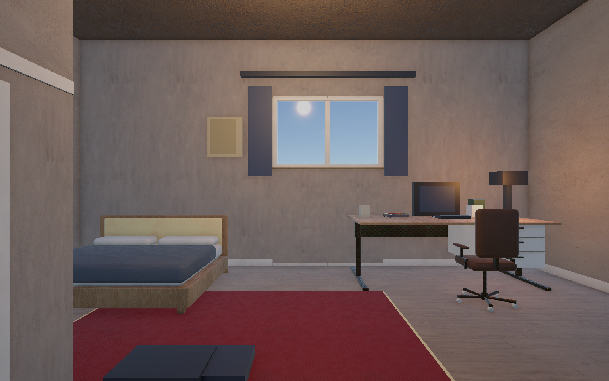

# D-EXPRESSIVE

방 안의 작은 행동과 선택으로 10일을 보내는 1인칭 심리 서사 게임 프로토타입입니다. 식사, 씻기, 연락, 정리와 휴식을 선택하며 정신력과 방의 변화를 경험합니다.



## 바로 실행

통합 배포 ZIP을 **전체 압축 해제**한 뒤 `Builds/Windows/DExpressive.exe`를 실행하세요. Unity를 설치할 필요가 없습니다. EXE와 같은 폴더의 `DExpressive_Data`, `UnityPlayer.dll`, `MonoBleedingEdge` 등을 함께 유지해야 합니다.

GitHub에서 소스만 받은 경우 실행 파일은 Releases의 `DExpressive-Windows-x64.zip`을 받습니다. 이 저장소의 소스만으로는 EXE가 포함되지 않으므로 아래 Unity 빌드 절차를 사용해도 됩니다.

## 조작

| 입력 | 기능 |
| --- | --- |
| WASD / 마우스 | 이동 / 시점 이동 |
| F | 바라보는 물건 조사, 욕실 문 열기·닫기 |
| 마우스 클릭 또는 1·2 | 대화 선택지 선택 |
| Esc | 일시정지 / 계속하기 |
| F5 / F9 | 저장 / 불러오기 |
| Alt+F4 | 게임 종료 |

제목 화면에서 **새 게임 시작** → 첫 대화의 선택지 → 방 탐색 순서로 진행합니다. 침대에서 다음 날로 넘어갑니다. 같은 행동 중 일부는 하루 한 번만 가능합니다.

## 현재 구현

- DAY 1~10의 대화, 선택지, 목표와 방 변화
- 정신력, 하루 행동 기록, 체크포인트와 이전 날짜로 회귀
- 로컬 저장·불러오기, 제목·일시정지·엔딩 화면
- 기존 SampleScene의 시스템을 유지한 URP 실내 에셋 통합
- 도시락 식사, 휴대폰 연락, 약, 창문, 거울, 씻기, 정리, 침대와 현관문
- 욕실 문 개폐·충돌·끼임 방지, 신발장 옆 쓰레기통, 책상과 의자 방향 정렬
- 냉장고는 가구로만 사용하며 식사 기능은 도시락에만 연결

## 문서

- **[에셋 파일 찾기](에셋_찾기.md)**: 실제 모델·텍스처·재질·프리팹 위치
- [에셋 적용 안내](docs/ASSET_GUIDE_KO.md) / [전체 파일 목록](docs/ASSET_INVENTORY.csv)
- **[클로드 인계용 프롬프트](docs/CLAUDE_HANDOFF_KO.md)**: 현재 상태와 보존 조건, 검증·빌드 방법을 그대로 전달
- [게임 내용 정리](docs/GAME_OVERVIEW_KO.md): 이야기, 날짜별 흐름, 기능, 공간과 오브젝트
- [실행·개발·빌드](docs/RUN_AND_BUILD_KO.md): 저장 위치, Unity 실행, Windows 빌드
- [GitHub 업로드](docs/GITHUB_UPLOAD_KO.md): 소스 업로드와 실행 파일 배포
- [검증 결과](docs/VERIFICATION_KO.md): 에디터 검사와 실행 파일 확인 범위
- [외부 에셋·라이선스](THIRD_PARTY_NOTICES.md): 출처와 확인된 이용 조건
- [변경 기록](CHANGELOG.md)

## Unity에서 개발

Unity **6000.3.22f1**, URP **17.3.0**, Windows x64 기준입니다. Unity Hub에서 `Assets`, `Packages`, `ProjectSettings`가 있는 이 폴더를 추가하고 `Assets/Scenes/SampleScene.unity`를 엽니다. 첫 실행에는 패키지 다운로드와 에셋 임포트가 필요합니다.

메뉴 **DExpressive → Build Windows Release**로 실행 파일을 만듭니다. 결과는 `Builds/Windows`에 생성됩니다. `InteriorKitTest`는 별도의 에셋 테스트 씬이고 실제 게임의 시작 씬은 SampleScene입니다.

## 저장소 구성

```text
Assets/           게임 코드, 씬, 프리팹, 모델, 재질
Packages/         Unity 패키지 목록과 잠금 파일
ProjectSettings/  Unity 프로젝트 설정
docs/             게임 설명, 실행·배포 안내, 검증 및 이미지
Builds/Windows/   통합 ZIP의 Windows 게임; Git 업로드에서는 제외
Backups/          기존 시스템 보존 비교용 파일
```

Git 캐시·Unity 캐시·사용자 저장 파일은 배포에서 제외합니다. 외부 모델의 원본 재배포 허가가 모두 확인된 것은 아니므로 **소스는 우선 비공개 저장소에 업로드**하고, 공개 배포 전에는 THIRD_PARTY_NOTICES.md의 미확인 항목을 확인하세요. 프로젝트 전체에 임의의 오픈소스 라이선스를 부여하지 않았습니다.
