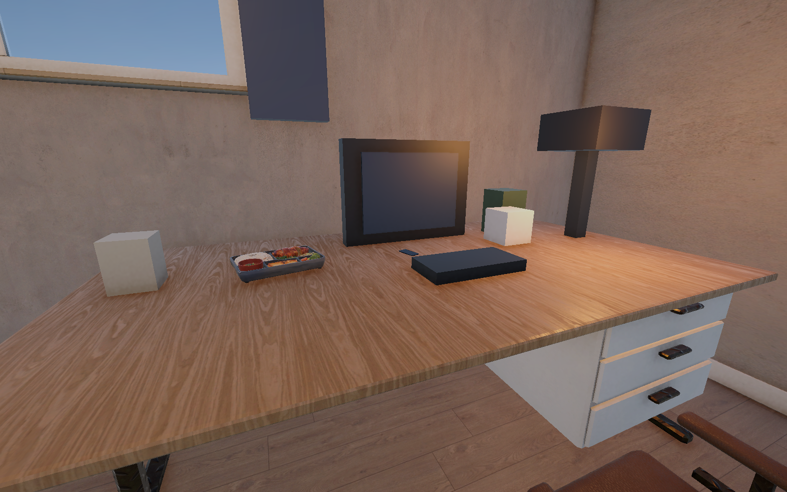
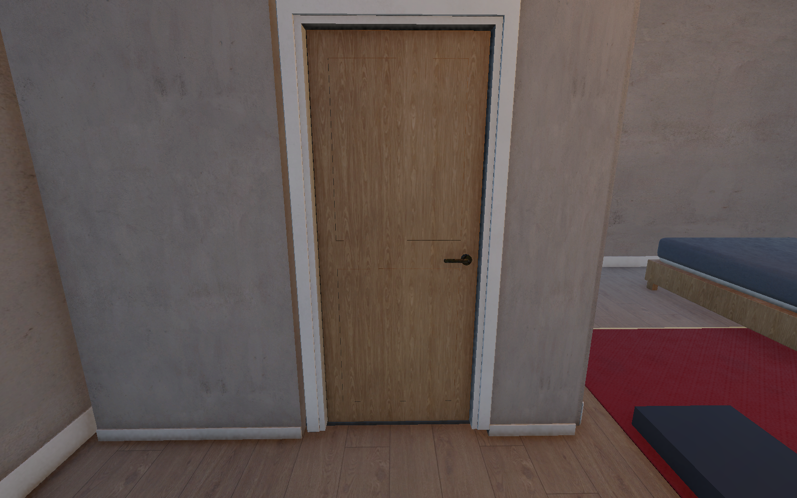
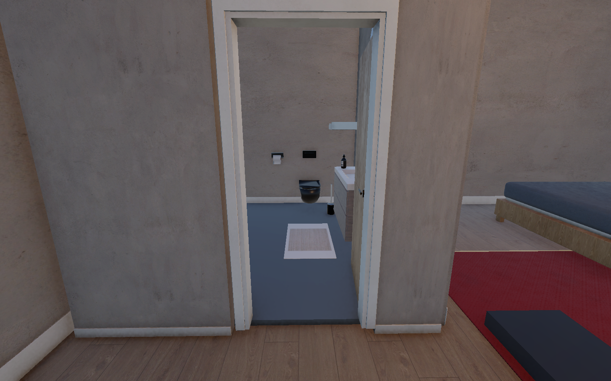
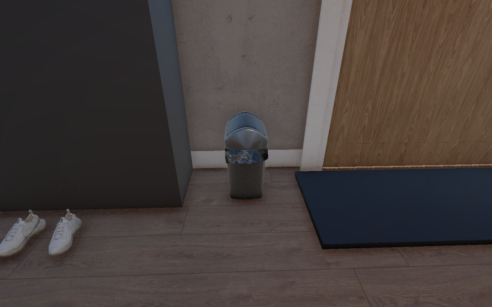

# D-EXPRESSIVE 게임 내용 정리

정리 기준: 2026-11-04 / 배포 버전 0.1.0

## 게임의 방향

D-EXPRESSIVE는 우울과 회복의 일상을 소재로 한 1인칭 심리 서사 프로토타입입니다. 플레이어는 방 안에서 사소한 행동을 선택하며 열흘을 보냅니다. 초반의 반복과 무기력에서 연락과 작은 행동을 거쳐, 마지막에는 문 밖으로 한 걸음을 내딛는 흐름입니다.

조작의 중심은 이동, 물건 조사, 대화 선택입니다. 화면의 날짜·정신력·오늘의 작은 목표가 현재 상태를 알려 줍니다. 현재 버전은 하나의 방과 욕실을 중심으로 한 플레이 가능한 프로토타입이며, 상점·전투·멀티플레이 등의 기능은 구현 범위에 포함되지 않습니다.

## 기본 플레이 흐름

1. 제목 화면에서 새 게임 또는 저장 불러오기를 선택합니다.
2. 날짜의 도입 대화와 목표를 확인합니다.
3. 방을 돌아다니며 물건을 바라보고 F를 눌러 행동을 선택합니다.
4. 선택에 따라 정신력과 선택 기록, 물건의 표시 상태가 바뀝니다.
5. 침대에서 잠들면 다음 날로 전환됩니다.
6. 정신력이 0이 되면 이전 날짜의 시작 체크포인트로 돌아갑니다. DAY 1에서는 DAY 1로 돌아갑니다.
7. 후반부 현관문 선택을 통해 엔딩으로 이어집니다.

## 날짜별 이야기

아래 표는 코드에 정의된 제목·도입과 목표의 요약입니다. 플레이 선택에 따라 실제 기록과 정신력은 달라집니다.

| 날짜 | 제목 | 이야기와 목표 |
| --- | --- | --- |
| DAY 1 | 수레바퀴 | 정리되지 않은 방에서 시작합니다. 방 안에서 할 일을 하나 찾아봅니다. |
| DAY 2 | 손상 | 익숙한 행동도 무겁게 느껴집니다. 작은 일 하나를 선택합니다. |
| DAY 3 | 균열 | 간단한 일에 시간이 걸립니다. 식사·씻기처럼 몸을 돌봅니다. |
| DAY 4 | 늪 | 해야 할 일을 알지만 움직이기 어렵습니다. 연락 또는 정리를 시도합니다. |
| DAY 5 | 침잠 | 작은 행동도 선택이 됩니다. 거울을 통해 자신을 마주합니다. |
| DAY 6 | 낙하 | 수면과 여유가 부족합니다. 짧은 답장을 시도합니다. |
| DAY 7 | 격돌 | 혼자 감당하기 어렵다고 느낍니다. 친구 또는 부모님에게 연락합니다. |
| DAY 8 | 혼란 | 전날 대화에 후회와 안도감이 남습니다. 대화를 이어갈지 선택합니다. |
| DAY 9 | 비상 | 문 앞에 서고 문고리를 잡습니다. 현관문을 여는 선택에 문 애니메이션이 연결됩니다. |
| DAY 10 | 발걸음 | 방 밖으로 나갈 준비를 합니다. 밖으로 한 걸음 선택으로 엔딩이 재생됩니다. |

## 주요 시스템

### 대화와 선택

`DialogueDatabase`와 `StoryContentFactory`가 날짜와 행동에 맞는 대화를 제공합니다. `DialogueManager`와 `ChoiceManager`가 선택지를 표시하고 정신력·스토리 플래그·선택 기록에 반영합니다. 이미 하루 한 번 수행한 식사·복약·거울·씻기·정리는 같은 날 다시 실행되지 않습니다.

### 정신력과 날짜

정신력은 HUD에 표시됩니다. 선택과 날짜 시작 효과에 따라 변합니다. 하루 동안 아무 행동 없이 잠들면 30 감소합니다. 하루 행동 기록이 있는지 검사하며, 욕실 문을 여닫는 것 자체는 하루 행동으로 기록하지 않습니다.

날짜가 시작될 때 체크포인트를 만들고, 정신력 소진 시 이전 날짜 체크포인트의 상태를 복원합니다. 회귀 시 정신력·날짜·선택 기록 등의 게임 상태를 되돌리고 전환 연출을 표시합니다.

### 저장과 복원

저장은 로컬 단일 슬롯 JSON입니다. 현재 상태와 날짜별 체크포인트를 함께 저장합니다. 날짜·정신력·스토리 플래그·완료 행동·선택 기록을 복원하고, 먹은 도시락이나 정리한 물건도 기록에 맞춰 다시 표시합니다. F5로 저장하고 F9 또는 제목 메뉴에서 불러옵니다. 욕실 문의 열림 상태는 저장 대상이 아니며 장면 시작 시 닫혀 있습니다.

### 공간 연출

날짜와 정신력에 따라 조명·창문 색과 화면 효과가 달라집니다. 종이·옷·포장 등 방의 흔적도 날짜에 따라 달라집니다. 잠자기 전환, 회귀 페이드, 현관문 개방과 마지막 엔딩 화면이 연결되어 있습니다.

## 공간과 오브젝트

기존 `SampleScene`과 방 자동 생성 구조를 유지한 상태에서, 벽·바닥·천장과 대응되는 가구를 Interior Kit 모델로 교체했습니다. 방 생성 → 실내 에셋 교체 → 추가 소품 배치 순서로 실행됩니다. 별도 테스트 씬의 생성기나 플레이어가 실제 게임에 중복 생성되지 않도록 구성했습니다.

| 위치·물건 | 적용 모델·상태 | 플레이 기능 |
| --- | --- | --- |
| 벽·바닥·천장·창문 | Interior Kit, URP 재질과 충돌 정리 | 방 경계와 창문 조사 |
| 침대 | Interior Kit | 잠자기, 다음 날 진행 |
| 책상·의자 | Interior Kit, 의자 180도 회전 후 정렬 | 책상 위 행동 공간 |
| 컴퓨터·키보드 | 기존 구조 유지, 모니터 90도 회전 및 위치 수정 | 환경 오브젝트 |
| 도시락 | 제공된 일본식 도시락 모델 | 식사 선택지, 먹은 뒤 숨김, 다음 날 복원 |
| 휴대폰 | 제공된 휴대폰 모델 | 날짜별 연락·답장 선택지 |
| 냉장고 | 제공된 냉장고 모델 | 가구; 식사 기능 제거 |
| 쓰레기통 | 제공된 플라스틱 모델, 신발장과 현관문 사이 | 정리 선택지, 내용물과 컵 정리 |
| 신발 | 제공된 신발 모델 한 쌍 | 신발장 앞 장식 |
| 세면대·거울 | 욕실 모델 | 기존 씻기·거울 행동 |
| 샤워 공간·욕조 | 욕실 모델 | 기존 하루 씻기 기록 공유 |
| 변기·휴지·변기솔 | 욕실 모델 | 환경 오브젝트 |
| 수건·비누·매트·선반 | 욕실 모델 | 환경 오브젝트 |
| 세탁기 | 복합 욕실 FBX에서 분리한 모델 | 환경 오브젝트 |
| 욕실 입구 문 | Interior Kit 문, 새 경첩과 Collider | F키 열기·닫기, 닫힌 문 통과 차단, 끼임 방지 |
| 현관문 | 기존 스토리와 연결된 문 | DAY 9 개방, DAY 10 엔딩 |
| 약·컵·옷·메모·옷장·화분 등 | 대응 모델이 불명확한 기존 물건 유지 | 기존 행동 또는 환경 표현 유지 |

욕실 문은 안쪽으로 열립니다. 플레이어가 문 사이에 있으면 닫힘을 멈추며 비켜나면 닫힘을 계속합니다. 현관문의 엔딩 기능과 별도로 작동합니다.

## 개발 구조

| 영역 | 주요 코드 |
| --- | --- |
| 상태 | GameStateData, GameStateManager |
| 대화·이야기 | DialogueManager, DialogueDatabase, StoryContentFactory, ChoiceManager |
| 날짜·회귀 | DayManager, CheckpointManager, RollbackManager |
| 저장 | PrototypeSaveManager |
| 이동·조사 | FirstPersonPlayerController, PrototypeInteractionTarget, PrototypeInteractionController |
| 방 생성·에셋 | PrototypeRoomBootstrap, InteriorKitGamePalette, AdditionalRoomPropsPalette |
| 시각 상태 | RoomActionVisuals, RoomMoodController, DailyRoomEvolution, DayPresentationController |
| 문·전환·엔딩 | BathroomDoorController, DoorEndingController, SleepTransitionController |
| 화면·한글 | PrototypeGameUI, ChoiceUI, DayHUD, MentalStateHUD, KoreanFontBootstrap |

## 현재 한계와 후속 작업

- 전체 선택 조합에 대한 수동 완주 검사는 수행하지 않았습니다. 자동 진행 검증과 실행 파일 기본 동작 확인 범위는 별도 검증 문서에 적었습니다.
- 일부 물건은 기존 단순 모델을 유지했습니다. 대응 에셋을 제공받으면 기능을 보존하면서 교체할 수 있습니다.
- 욕실 문 열림 상태 저장, 다중 저장 슬롯, 세부 그래픽·감도 설정은 현재 구현 범위 밖입니다.
- 구체적인 최소 사양과 다른 PC에서의 호환성·성능은 측정하지 않았습니다. 배포 대상은 Windows x64입니다.
- 외부 모델의 제작자·배포 페이지·허가 조건 중 제공 파일에 없는 항목은 추가 확인이 필요합니다.
