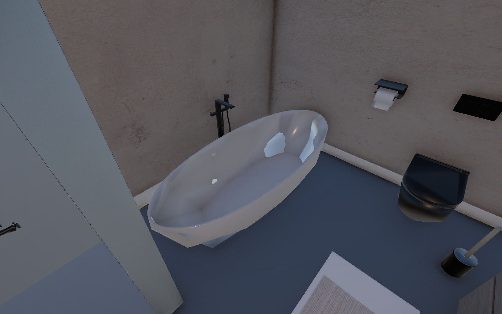

# v0.2.2 제출·실행 안내

이번 제출은 사용자가 제공한 최종 D-Expressive-master.zip을 바탕으로 실내 에셋, 책상 종이·약봉투 교체, 욕조 회전·확대까지 반영한 버전입니다. Unity 프로젝트 루트는 저장소의 DExpressive 폴더입니다. 기존 원격 master 브랜치는 유지하며 최종 코드와 에셋 통합본을 main에 제출합니다.

## 실행

릴리스에서 DExpressive-v0.2.2-Windows.zip을 받아 전체를 압축 해제하고 DExpressive.exe를 실행하세요. Unity 설치는 필요하지 않습니다. exe 옆의 Data 폴더 및 DLL을 제거하면 실행되지 않습니다.

소스는 Unity 6000.3.22f1에서 DExpressive 폴더를 열고 Assets/Scenes/SampleScene.unity를 실행하세요. 에셋을 포함한 전체 소스는 Git 저장소에서 받을 수 있으며 Library 등 자동 생성 캐시는 제외했습니다. 별도 에셋 ZIP도 제공합니다.

## 최신 변경

- 종이 더미와 약봉투 프리팹이 기존 정리·복약 대상과 연결됩니다.
- 욕조는 벽 쪽 수도꼭지 방향으로 180도 반전하고 약 1.98 × 0.94 × 0.84m로 확대했습니다.
- 욕실 문 열기·닫기와 충돌, 음식 전용 식사 기능, 생활 소품 및 기존 전체 게임 진행을 유지합니다.
- 클로드 전용 프롬프트 파일은 이번 소스와 릴리스에서 제외했습니다. 과거 이력과 릴리스에는 기존 자료가 남아 있습니다.

## 검증 근거

- Unity 실제 Play 모드 전체 통합 검사: **361 PASS**. Day 1~10 목표와 진행, 엔딩, 정신력·회귀, 저장 복원, 욕실 문과 에셋, 욕조 크기·방향·공간 배치 포함. FinalMasterAssetValidation.txt.
- 기존 EditMode 스토리 검사: **12 PASS, 실패 0**. MasterEditModeResults.xml.
- 종이·약봉투 동작에 대한 앞선 Play 모드 검사: **33 PASS**. DeskPropsValidation.txt.
- 최종 master 핵심 스토리·진행·저장·오디오 등 보호 대상 파일 58개 원본 유지. MasterPreservation.json.
- 최신 Windows 빌드 결과는 WindowsBuild-v0.2.2.txt에 기록합니다. Unity Play 검증과 Windows 빌드 검증을 수행했으며 이 버전의 Windows 플레이어 전체 수동 플레이를 완료했다는 의미는 아닙니다.

기존 0.2.0/0.2.1 빌드·검증 문서는 과거 기록입니다. 최신 실행 파일은 v0.2.2 릴리스를 사용하세요.

에셋 경로와 목록은 ASSET_GUIDE_KO.md 및 ASSET_INVENTORY.csv를 확인하세요. 외부 파일의 이용 조건과 원문 안내는 THIRD_PARTY_NOTICES.md 및 각 에셋 폴더에 보존했습니다.
