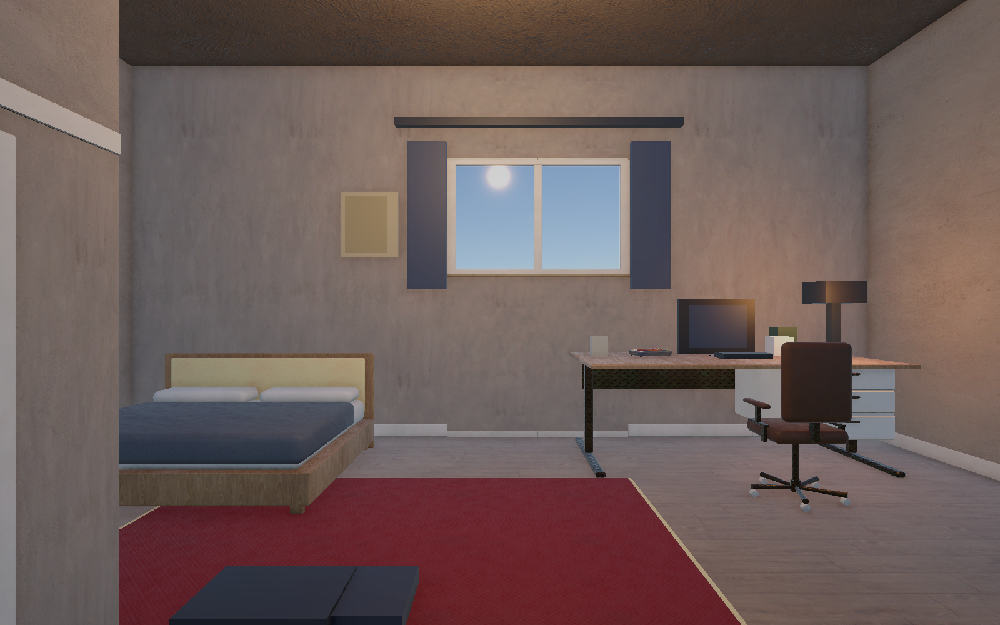

# D-EXPRESSIVE — 제출 자료

방 안에서 작은 행동과 선택으로 열흘을 보내는 1인칭 심리 서사 게임입니다. 기존 DAY 1~10·정신력·저장·체크포인트·회귀·엔딩을 유지하고 실내·가구·욕실·생활 소품을 적용한 Windows 프로토타입입니다.

## 게임 실행 파일

**[Windows 게임과 에셋 ZIP 다운로드 — Releases](https://github.com/kkk1038/D-Expressive/releases/tag/v0.1.0)**

`DExpressive-Windows-x64.zip` 전체를 풀고 `DExpressive.exe`를 실행하세요. Unity 설치는 필요 없습니다. EXE·Data·DLL·MonoBleedingEdge를 함께 유지합니다. 소스의 Code → Download ZIP에는 빌드 결과가 없으므로 게임 실행만 할 경우 Releases를 사용하세요.

WASD 이동 / 마우스 시점 / F 조사·욕실 문 개폐 / 클릭·1·2 선택 / Esc 메뉴 / F5 저장 / F9 불러오기 / Alt+F4 종료.

## 제출 문서와 인계

| 자료 | 링크 |
| --- | --- |
| 게임 내용·스토리·기능 정리 | [게임 정리 문서](DExpressive/docs/GAME_OVERVIEW_KO.md) |
| 에셋이 들어 있는 위치 | **[에셋 찾기](DExpressive/에셋_찾기.md)** |
| 에셋별 원본·프리팹·적용 방법 | [에셋 안내](DExpressive/docs/ASSET_GUIDE_KO.md) |
| 에셋 파일·GUID·크기·해시 목록 | [전체 에셋 CSV](DExpressive/docs/ASSET_INVENTORY.csv) |
| 에셋 참조 검사 | [참조 검사 JSON](DExpressive/docs/ASSET_REFERENCE_CHECK.json) |
| 클로드에게 바로 전달할 내용 | **[클로드 인계 프롬프트](CLAUDE_HANDOFF_KO.md)** |
| 실행·저장·Unity 빌드 방법 | [실행·개발 안내](DExpressive/docs/RUN_AND_BUILD_KO.md) |
| 검사와 실제 EXE 확인 범위 | [검증 결과](DExpressive/docs/VERIFICATION_KO.md) |
| 외부 자료 이용 조건 | [출처·라이선스](DExpressive/THIRD_PARTY_NOTICES.md) |

## 소스와 에셋

Unity 프로젝트는 **`DExpressive/`** 폴더입니다. Unity **6000.3.22f1**, URP **17.3.0**으로 열고 `Assets/Scenes/SampleScene.unity`를 실행합니다.

- `DExpressive/Assets/ThirdParty/InteriorKitV1`: 벽·바닥·천장·가구·문·창문 모델, 텍스처, URP 재질, 프리팹
- `DExpressive/Assets/ThirdParty/AdditionalProps`: 욕실·도시락·휴대폰·신발·냉장고·쓰레기통의 변환 메시, 텍스처, 재질, GamePrefabs
- `DExpressive/Assets/Scripts`: 게임과 에셋 배치 코드
- `DExpressive/Packages`, `ProjectSettings`: 프로젝트 복원 설정

독립 에셋 ZIP도 Releases에 첨부합니다. 소스에는 같은 에셋이 이미 들어 있습니다. Library·Temp·개인 저장 파일과 실행 빌드의 Git 중복 업로드는 제외했습니다.

## 검증과 현재 상태

Windows x64 빌드 오류 0·경고 0, 에디터 Play 모드 327개 검사 통과. 실제 EXE의 제목·한글·새 게임·대화와 소품 표시를 확인했습니다. 모든 선택 조합의 수동 완주 및 다른 PC 성능 검사는 별도입니다.

새 ThirdParty·Palette의 검사 대상 참조에 누락은 없으며, 기존 CuteMagic 샘플 원본의 미해결 GUID 39건은 별도 기록했습니다. 외부 모델의 공개 재배포 조건 중 미확인 항목이 남아 있어 저장소의 비공개 설정을 유지합니다.
